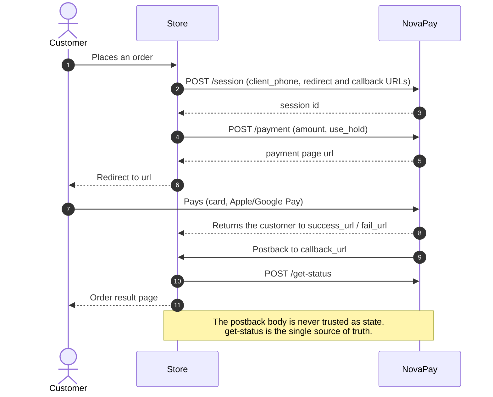
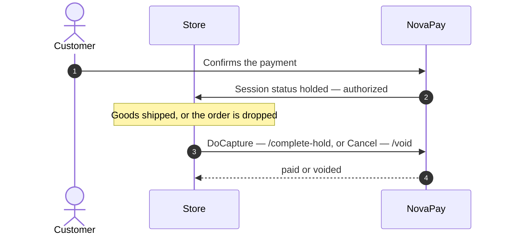

# Payum NovaPay

Provides [NovaPay eCommerce acquiring](https://novapay.readme.io/reference/introduction-to-novapay-api-integration)
(the payment service of the Nova Poshta group) integration for
[Payum](https://github.com/Payum/Payum): hosted checkout with instant debit
or two-stage hold payments, and refunds.

Supported operations:

- `Capture` — create a payment session (`/session` + `/payment`) and redirect
  the customer to the NovaPay payment page (`url`).
- `Authorize` — same flow with `use_hold=true`: the funds are locked on the
  customer's card and the store settles the payment later.
- `DoCapture` (the shared request from `sol-parts/payum-contracts`, when
  installed) — settle a held payment via `/complete-hold`, full or partial
  amount.
- `Cancel` — reversal of a held payment via `/void`: the lock on the
  customer's funds is released. For a not-yet-paid session it is a no-op —
  the session simply expires on its own.
- `Refund` — refund of a paid session via `/void`, full session amount.
- `Notify` — the postback is treated as a sync trigger only: the state is
  always re-fetched from the NovaPay API (`/get-status`), so a forged
  callback can at most trigger an extra sync.
- `Sync` — re-fetch the session state via `/get-status`.
- `GetStatus` — maps NovaPay session statuses to Payum ones (see the table
  below).

## Payment flow



`Authorize` creates a hold payment: the money is locked instead of charged
until the store settles or releases it:



While a session is still payable (`created` / `processing`) the capture flow
does not create a new one: the returning customer is redirected back to the
same NovaPay payment page (`url`) until the session is paid or expires.

## Status mapping

| Session status | Payum status |
|---|---|
| `created`, `processing` | pending |
| `holded`, `hold_confirmed`, `processing_hold_completion` | authorized — the funds are locked, the store settles via `DoCapture` |
| `paid` | captured |
| `processing_void` | pending |
| `voided` | refunded — covers both a released hold and a refunded payment; the host application distinguishes them by the previous transaction state |
| `failed` | failed |
| `expired` | expired |

## Installation

```bash
composer require sol-parts/payum-novapay
```

## Usage with PayumBuilder

```php
use Payum\Core\GatewayFactoryInterface;
use Payum\Core\PayumBuilder;
use SolParts\PayumNovaPay\NovaPayGatewayFactory;

$payum = (new PayumBuilder())
    ->addGatewayFactory('novapay', static function (array $config, GatewayFactoryInterface $coreGatewayFactory) {
        return new NovaPayGatewayFactory($config, $coreGatewayFactory);
    })
    ->addGateway('novapay', [
        'factory' => 'novapay',
        'merchant_id' => 'your-merchant-id',
        'merchant_private_key' => file_get_contents('/path/to/merchant-private-key.pem'),
        'sandbox' => false,
    ])
    ->getPayum();
```

## Usage with Symfony PayumBundle

Register the gateway factory:

```yaml
# config/services.yaml
services:
    app.novapay_gateway_factory:
        class: Payum\Core\Bridge\Symfony\Builder\GatewayFactoryBuilder
        arguments: [SolParts\PayumNovaPay\NovaPayGatewayFactory]
        tags:
            - { name: payum.gateway_factory_builder, factory: novapay }
```

Configure a gateway:

```yaml
# config/packages/payum.yaml
payum:
    gateways:
        novapay:
            factory: novapay
            merchant_id: '%env(NOVAPAY_MERCHANT_ID)%'
            merchant_private_key: '%env(NOVAPAY_MERCHANT_PRIVATE_KEY)%'
            sandbox: false
```

## Options

| Option | Required | Description |
|---|---|---|
| `merchant_id` | yes | Merchant identifier issued by NovaPay, sent both in the request body and as the `merchant_id` header. |
| `merchant_private_key` | yes | PEM-encoded RSA private key of the merchant. Every request body is signed with RSA-SHA256 and the base64 signature is sent as the `x-sign` header. |
| `sandbox` | no (default `true`) | `true` targets the sandbox endpoint (`api-qecom.novapay.ua`), `false` — production (`api-ecom.novapay.ua`). |

## Payment details

`ConvertPaymentAction` fills `amount` — **in hryvnias (major units)**, as the
NovaPay API expects, converting from the minor-unit total of the payment —
and `external_id` with the payment number.

The only client field NovaPay requires is `client_phone` (E.164, `+380…`);
`client_first_name`, `client_last_name`, `client_patronymic` and
`client_email` are optional. The gateway passes them through from the payment
details supplied by the host application.

The gateway attaches `success_url` / `fail_url` to the long-lived after-URL
token and `callback_url` to a notify token. NovaPay bakes these URLs into the
session permanently and reuses the session on payment retries, which is
exactly why the redirect target must survive repeated visits.

## Caveats

- `amount` is in major units (hryvnias with kopecks as the fraction), unlike
  most card gateways working in minor units. The partial `amount` of
  `DoCapture` is in major units too.
- `/void` is a single endpoint for both reversal of a hold and refund of a
  paid session. The gateway always voids the full session amount; partial
  refunds via `operations[]` are not implemented.
- NovaPay refunds a paid session only until 23:59 of the payment day. Later
  returns have to be settled outside the acquiring API.
- A failed payment attempt does not kill the session: it stays payable until
  it expires, and the capture flow redirects the returning customer back to
  the same payment page for another attempt.
- The postback body is deliberately not parsed and its signature is not
  verified: the state is always re-fetched via `/get-status` under the
  merchant credentials, and the notify URL itself carries an unguessable
  Payum token.
- Successful `/void` and `/complete-hold` calls may answer with an empty body
  or JSON `null` — the gateway treats both as "accepted, no structured body".
- Error responses are reported with the HTTP status code and a truncated body
  snippet — balancer errors (429, 5xx) answer with HTML, not JSON.

## License

Released under the [MIT License](LICENSE).
